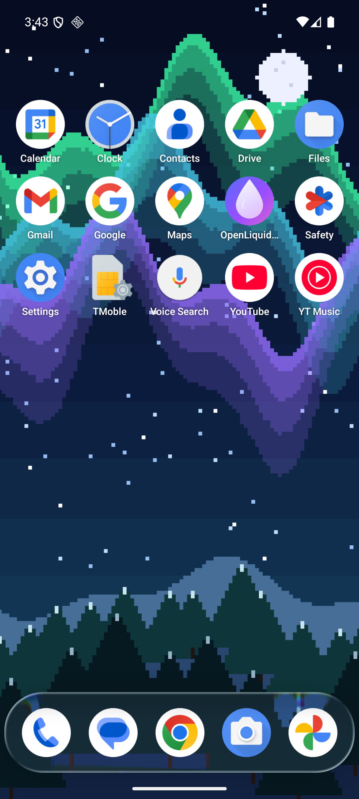
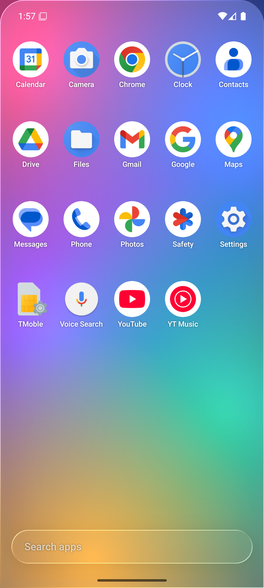
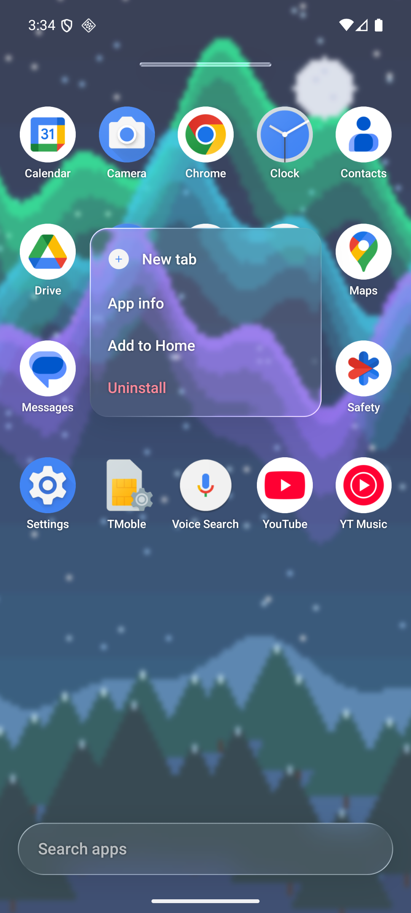
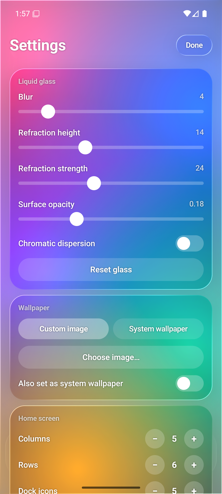

# OpenLiquidLauncher

An open-source Android launcher where **everything is liquid glass**. Dock, app drawer, folders, context menus, widget cards and settings are refracting, blurring glass layers over your wallpaper, powered by [Kyant0/AndroidLiquidGlass](https://github.com/Kyant0/AndroidLiquidGlass).

| Home | Drawer | Menu | Settings |
|---|---|---|---|
|  |  |  |  |

## Features
- Paged home grid (default 5×6) with a glass dock; drag & drop, folders (drop an app on another), widgets
- Paged horizontal app drawer with search, as a full-screen glass sheet
- Long-press menu with app shortcuts, app info, remove, uninstall
- Wallpaper: pick an image in-app (optionally also set as system wallpaper) or use the system wallpaper — the glass refracts it
- Notification badges, themed (monochrome) icons, each app's own icon as installed
- Gestures: swipe up (drawer), swipe down (notifications), double tap (lock), pinch (edit mode)
- Tunable glass: blur, refraction height/strength, surface opacity, chromatic dispersion; grid, dock and icon size

## Importing your layout from another launcher (e.g. OnePlus / OxygenOS)
Settings → **Import** has two ways to copy your dock, pages, folders, widgets and grid size from another Launcher3-style launcher:
1. **Import from my current launcher** reads the other launcher's layout provider. This only works if that launcher lets other apps read it; many system launchers (Pixel Launcher, possibly OxygenOS) refuse, and the app then tells you which provider was denied.
2. **Import from launcher.db file…** reads a copy of the launcher's database (`databases/launcher.db`, table `favorites`). You need root or a backup tool to get it, e.g. `su -c cp /data/data/<launcher package>/databases/launcher.db /sdcard/` (the OnePlus launcher package is typically `com.android.launcher`; check with `pm list packages | grep -i launcher`).

Apps are matched by component, so only installed apps are imported. Widgets can't be copied directly: each one asks you to confirm and is then placed at its original cell.

## Requirements
Android 13+ (API 33): the real glass effect uses AGSL runtime shaders.

## Build
```
./gradlew :app:assembleDebug
```
Then set it as your default home app in Android settings.

## Permissions
- Notification access (optional) — badges
- Accessibility service (optional) — double-tap lock / swipe-down shade; reads no content
- All files access (optional) — only to read the *system* wallpaper on Android 13+

## About Launcher3
This project is inspired by AOSP Launcher3's architecture but is a fresh Compose codebase; see `CLAUDE.md` for why.

## License
Apache-2.0. Liquid glass effect by [Kyant0](https://github.com/Kyant0/AndroidLiquidGlass) (Apache-2.0).
